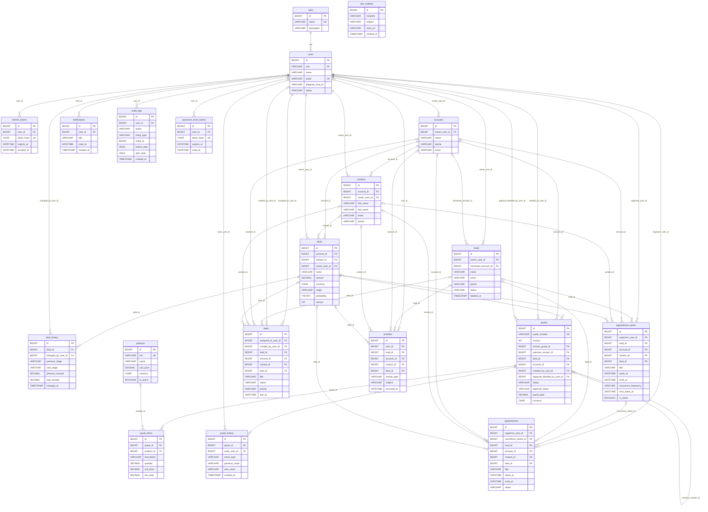

# Nexus CRM - Entity Relationship Diagram

Sơ đồ dưới đây được lập từ schema MySQL hiện tại trong
[`packages/api/sql/schema.mysql.sql`](../packages/api/sql/schema.mysql.sql).
Sơ đồ bao gồm 20 bảng và các quan hệ khóa ngoại được khai báo trong schema.
Các thuộc tính trong từng bảng tập trung vào khóa chính, khóa ngoại và thông
tin nghiệp vụ chính để sơ đồ dễ đọc; schema SQL là nguồn đầy đủ và chính xác
cho tất cả kiểu dữ liệu, ràng buộc và chỉ mục.



## Ghi chú

- `PK`: khóa chính; `FK`: khóa ngoại; `UK`: khóa duy nhất.
- `o|` biểu thị quan hệ có thể không có bản ghi liên quan; `||` biểu thị bắt
  buộc có đúng một bản ghi cha; `o{` biểu thị không hoặc nhiều bản ghi con.
- `audit_logs.entity_type` và `entity_id` là tham chiếu đa hình, không phải
  khóa ngoại SQL.
- `dev_mailbox` là bảng hộp thư phát triển, không có khóa ngoại.
- Để cập nhật sơ đồ sau khi đổi CSDL, hãy đối chiếu lại với
  `packages/api/sql/schema.mysql.sql` và các migration đã áp dụng.

## Xuất sơ đồ để đưa vào báo cáo

GitHub hiển thị sơ đồ Mermaid ngay trong tệp này. Để xuất ảnh, sao chép phần
nằm giữa dấu ```mermaid và dấu ``` cuối khối vào Mermaid Live Editor
(<https://mermaid.live/>), sau đó chọn **Actions → PNG**, **SVG** hoặc **PDF**.
